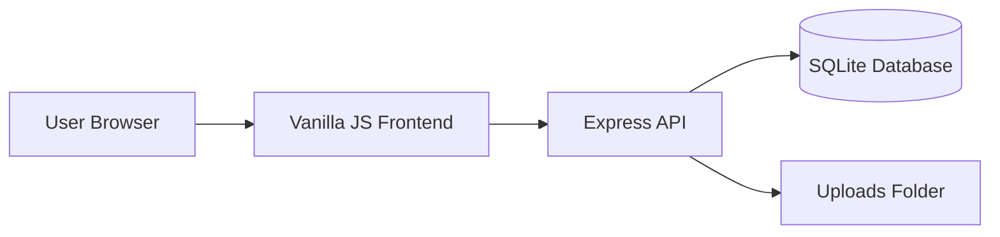

# Mini Insta Clone

A social media app inspired by Instagram, built with a simple JavaScript frontend and a Node.js/Express backend using SQLite.

This project has been updated to remove the React dependency and make the app easier to understand for beginners.

## Tech Stack

### Frontend
- Vanilla JavaScript
- HTML5
- CSS3
- Node.js static server

### Backend
- Node.js
- Express
- SQLite
- JWT authentication
- File uploads

## Architecture



## Features

- User signup and login
- personalized feed
- create posts with image upload
- like and unlike posts
- comments
- follow and unfollow users
- search users and posts
- profile pages

## Quick Start

### 1. Clone the repository

```bash
git clone https://github.com/mohddilshadkhan2003/Mini-Insta-Clone.git
cd Mini-Insta-Clone
```

### 2. Start the backend

```bash
cd backend
npm install
cp env.example .env
npm start
```

### 3. Start the frontend

```bash
cd frontend
npm install
npm start
```

The frontend runs on:

```text
http://localhost:3000
```

The backend runs on:

```text
http://localhost:5000
```

## Notes

- The frontend is intentionally simple and beginner-friendly.
- No React knowledge is required to work on this version.
- The backend API remains the same, so the app is still fully functional with the existing database and routes.

## Project Structure

```bash
Mini-Insta-Clone/
├── backend/
│   ├── database/
│   ├── middleware/
│   ├── routes/
│   ├── uploads/
│   ├── package.json
│   ├── server.js
│   └── .env.example
├── frontend/
│   ├── index.html
│   ├── styles.css
│   ├── app.js
│   ├── server.js
│   └── package.json
├── README.md
└── .gitignore
```

## License

MIT

---

This version keeps the app simple, readable, and easy to debug for learning purposes.


 


}


