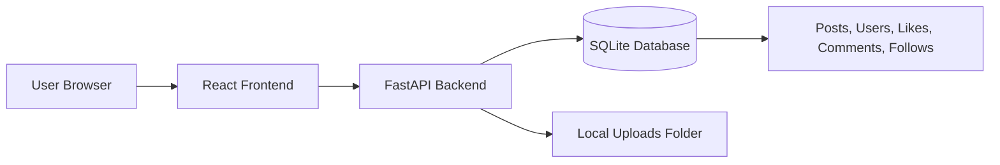
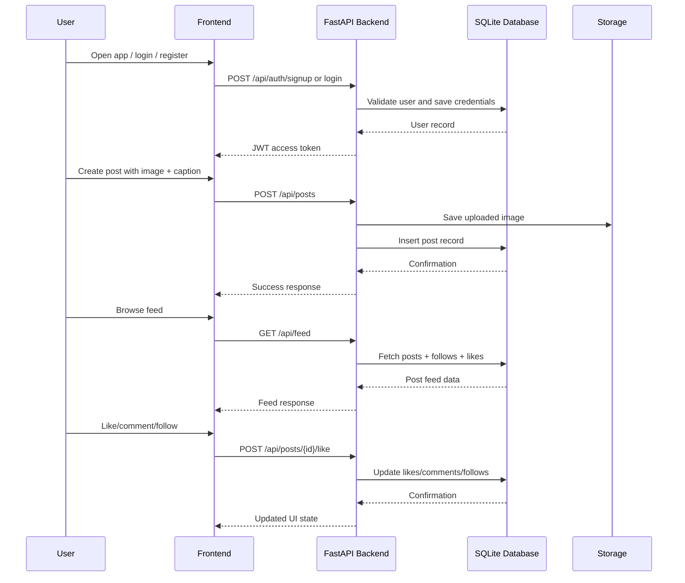

# Mini Insta Clone

A polished social media experience inspired by Instagram, built with a modern full-stack architecture that combines a React frontend with a Python FastAPI backend and SQLite database.

This project is designed to feel more authentic, dynamic, and production-ready while keeping the structure simple enough for learning, experimentation, and portfolio presentation.

[](https://react.dev/)
[](https://fastapi.tiangolo.com/)
[](https://www.sqlite.org/)
[](https://jwt.io/)
[](https://www.python.org/)
[](LICENSE)

## Overview

Mini Insta Clone is a social platform where users can:
- create accounts
- upload posts
- follow creators
- like and comment on content
- search for people/posts
- browse a personalized feed

The app is designed as a learning-friendly portfolio project, but it also feels real and usable.

## Architecture



## System Data Flow



## Features

- Secure signup and login using JWT
- Personalized feed based on follows
- Create posts with captions and images
- Like and unlike posts
- Comment on posts
- Follow and unfollow users
- Explore/search content by keyword
- Profile pages with follower counts and post stats
- Uploads stored locally for development use
- Clean REST API design with FastAPI

## Tech Stack

### Frontend
- React.js
- React Router
- Axios
- CSS / polished UI

### Backend
- Python 3.10+
- FastAPI
- SQLite
- JWT Authentication
- File uploads
- Python dotenv

## Project Structure

```bash
Mini-Insta-Clone/
├── backend/
│   ├── app/
│   │   ├── __init__.py
│   │   ├── config.py
│   │   ├── database.py
│   │   ├── main.py
│   │   └── security.py
│   ├── .env.example
│   ├── requirements.txt
│   └── uploads/
├── frontend/
│   ├── public
│   ├── src
│   ├── package.json
│   └── package-lock.json
├── README.md
├── .gitignore
└── LICENSE
```

## Prerequisites

Before running the project, install:

- Python 3.10 or later
- Node.js 18+
- npm
- Git

## Quick Start

### 1. Clone the repository

```bash
git clone https://github.com/mohddilshadkhan2003/Mini-Insta-Clone.git
cd Mini-Insta-Clone
```

### 2. Set up the backend (Python)

```bash
cd backend
python -m venv .venv
source .venv/bin/activate   # Linux/macOS
# Windows:
# .venv\Scripts\activate

pip install -r requirements.txt
cp .env.example .env
```

Then open `.env` and update the values if needed:

```env
APP_NAME=Mini Insta Clone
APP_ENV=development
APP_PORT=8000
JWT_SECRET=your-super-secret-key
JWT_ALGORITHM=HS256
DATABASE_PATH=./app/mini_insta.db
UPLOAD_DIR=./uploads
```

### 3. Run the backend

```bash
cd backend
source .venv/bin/activate   # Linux/macOS
# Windows:
# .venv\Scripts\activate

uvicorn app.main:app --host 0.0.0.0 --port 8000 --reload
```

The backend will run at:
```text
http://localhost:8000
```

### 4. Run the frontend

Open a second terminal and run:

```bash
cd frontend
npm install
npm start
```

The frontend should run at:

```text
http://localhost:3000
```

If your frontend is still using the old Node backend at port 5000, update the API base URL to:
```js
const API_URL = "http://localhost:8000";
```

## API Endpoints

### Authentication
- `POST /api/auth/signup`
- `POST /api/auth/login`
- `GET /api/auth/me`

### Feed
- `GET /api/feed?page=1`

### Posts
- `POST /api/posts`
- `GET /api/posts/{post_id}`
- `POST /api/posts/{post_id}/like`
- `POST /api/posts/{post_id}/unlike`
- `POST /api/posts/{post_id}/comment`

### Users
- `GET /api/users/{user_id}`
- `POST /api/users/{user_id}/follow`
- `POST /api/users/{user_id}/unfollow`

### Explore
- `GET /api/explore/search?q=searchterm`
- `GET /api/explore/suggestions`

## Example Requests

### Signup
```bash
curl -X POST "http://localhost:8000/api/auth/signup?username=alice&email=alice@example.com&password=password123"
```

### Login
```bash
curl -X POST "http://localhost:8000/api/auth/login?email=alice@example.com&password=password123"
```

### Create Post
```bash
curl -X POST "http://localhost:8000/api/posts?caption=hello+world" \
  -H "Authorization: Bearer YOUR_TOKEN" \
  -F "image=@/path/to/image.jpg"
```

## Development Notes

- The app uses SQLite for simplicity and fast local development.
- Uploaded images are stored in `backend/uploads`.
- For a production app, you can later migrate to PostgreSQL, cloud storage, and a proper deployment pipeline.
- This version is built for learning, portfolio display, and fast iteration.

## Roadmap

- [ ] Real-time notifications
- [ ] Stories
- [ ] Direct messaging
- [ ] Video uploads
- [ ] AI-powered content recommendations
- [ ] Deployment to Vercel / Railway / Render
- [ ] PostgreSQL migration

## License

This project is licensed under the MIT License.

## Author

Built with passion for creating a polished social app experience.

---

Made with care for a cleaner, more powerful, and more authentic social platform.
