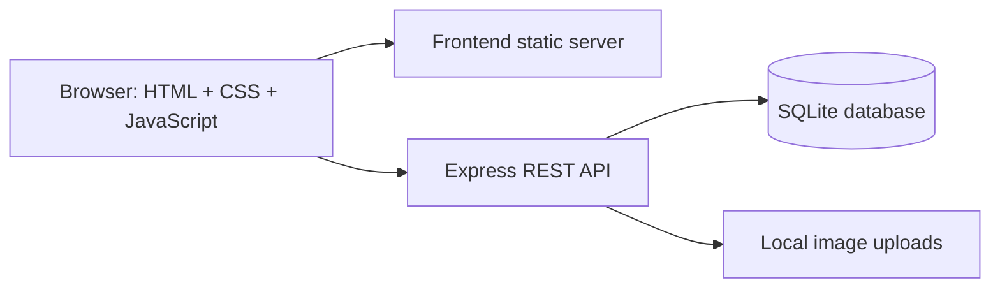

<div align="center">

# 📸 Mini Insta Clone

**A beginner-friendly social photo-sharing app — no React required.**

Build your community, share photos, and explore posts with a lightweight frontend and a simple REST API.

[](https://developer.mozilla.org/en-US/docs/Web/JavaScript)
[](https://nodejs.org/)
[](https://expressjs.com/)
[](https://sqlite.org/)

</div>

---

## ✨ About

Mini Insta Clone is a small Instagram-inspired app built to be approachable for people learning web development. The interface uses plain **HTML, CSS, and JavaScript**, while the backend provides authentication, posts, follows, likes, comments, search, and SQLite storage.

## 🚀 Features

- Create an account and log in with JWT authentication
- Share photo posts with captions
- Browse a feed from followed accounts
- Like and unlike posts
- Follow suggested users
- Search for users and posts
- Store account and post data in SQLite
- Keep uploaded images in a local folder during development

## 🧰 Technology

| Area | Technologies |
| --- | --- |
| Frontend | HTML, CSS, Vanilla JavaScript |
| Frontend server | Node.js built-in `http` module |
| Backend API | Node.js, Express |
| Database | SQLite with `better-sqlite3` |
| Authentication | JSON Web Tokens (JWT), `bcryptjs` |
| Image upload | Multer |

## 🏗️ How it fits together



## 📋 Prerequisites

- Node.js 18 or later
- npm (included with Node.js)
- Git

## ⚡ Get started

### 1. Download the project

```bash
git clone https://github.com/mohddilshadkhan2003/Mini-Insta-Clone.git
cd Mini-Insta-Clone
```

### 2. Install and start the backend

```bash
cd backend
npm install
```

Create a local `.env` file from the example:

```bash
# macOS / Linux
cp env.example .env

# Windows PowerShell
Copy-Item env.example .env
```

Set a private, unpredictable `JWT_SECRET` in `backend/.env`, then start the API:

```bash
npm start
```

The API listens at **http://localhost:5000**.

### 3. Install and start the frontend

Open a second terminal at the project root:

```bash
cd frontend
npm install
npm start
```

Open **http://localhost:3000** in your browser. The frontend calls the API at `http://localhost:5000` by default.

> Keep both terminal windows open while using the app.

## 🗂️ Project layout

```text
Mini-Insta-Clone/
├── backend/
│   ├── database/       # SQLite setup and database file
│   ├── middleware/     # Authentication and upload middleware
│   ├── routes/         # Auth, users, posts, feed, and explore APIs
│   ├── scripts/        # Optional development scripts
│   ├── uploads/        # Uploaded images (created/used by backend)
│   ├── server.js
│   └── env.example
├── frontend/
│   ├── index.html      # HTML page
│   ├── styles.css      # Page styling
│   ├── app.js          # Browser-side JavaScript
│   ├── server.js       # Small static-file server
│   └── package.json
└── README.md
```

## 🔌 API overview

The Express backend exposes these route groups:

| Route | Purpose |
| --- | --- |
| `/api/health` | Check that the backend is running |
| `/api/auth` | Sign up and log in |
| `/api/feed` | Load posts from followed accounts |
| `/api/posts` | Create posts, like/unlike, and comment |
| `/api/users` | Profiles and follow/unfollow actions |
| `/api/explore` | Search, explore posts, and suggestions |

Protected endpoints expect the login token in the `Authorization: Bearer <token>` header.

## 🧑‍🎓 Beginner notes

- **HTML** describes what appears on the page.
- **CSS** controls how the page looks.
- **JavaScript** handles interactions and calls the backend.
- **Express** receives API requests and works with the database.

There is no React, JSX, or frontend build step in this version. Start with `frontend/app.js` and `frontend/styles.css` when learning how the interface works.

## 🔐 Security and development

- Do not use the example JWT secret in a public deployment. Set a strong secret in your local `.env` and never commit that file.
- The included setup is intended for local learning and development, not as a production deployment configuration.
- Local uploads and the SQLite database are development storage; back them up before deleting generated files.

## 🛠️ Troubleshooting

- **The page does not load:** confirm the frontend server is running and open `http://localhost:3000`.
- **API requests fail:** confirm the backend is running at `http://localhost:5000` and check its terminal for errors.
- **Login does not work:** verify the backend `.env` exists and that database initialization completed.
- **Image uploads fail:** check that the backend process can write to its uploads directory and that the selected file is an image.

## 📄 License

This project is distributed under the MIT License. See [`LICENSE`](LICENSE) for details.

---

<div align="center">

Made for learning, building, and sharing. ✨

</div>
